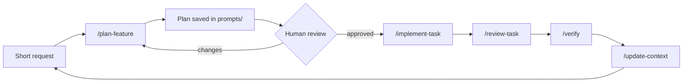

# Vibe Engineering Workflow — an AI coding setup where the human owns decisions

A ready-to-copy template for running an AI coding agent (OpenCode, also readable by Claude Code) on a real product codebase **without losing control of architecture**.

> Short direction from the human → AI writes a plan from the real code → human approves → AI implements only the plan → AI verifies → context files stay in sync.

Extracted from the workflow I use on a multi-tenant e-commerce SaaS (Next.js + NestJS monorepo, Arabic/English, RTL/LTR). The product code is not here — only the workflow.

## The loop

| Step | Command | Agent | Can edit code? |
|---|---|---|---|
| Plan | `/plan-feature <request>` | plan | No — writes only to `prompts/` |
| Implement | `/implement-task <plan>` | build | Yes — only files listed in the plan |
| Review | `/review-task <plan>` | plan | No |
| Verify | `/verify <scope>` | build | No — runs checks, reports |
| Sync | `/update-context <decision>` | build | Only `context/` + `decisions/` |

## Why each piece exists

| Piece | Problem it solves |
|---|---|
| `AGENTS.md` | One authoritative rulebook. Ownership, source-of-truth order, approval gate. |
| `context/` | Task-specific context. The agent loads only what the task needs, not everything. |
| `context/project-map.md` | A small map of the repo so the agent stops re-discovering the codebase every session. |
| `prompts/` | Plans are files, not chat. Any session (or any model) can pick up a saved plan. |
| `decisions/` | ADRs for anything the human approved that changes architecture. |
| `.opencode/commands/` | Each workflow step is a slash command with a fixed contract. |
| `.opencode/agents/` | Specialist reviewers with `edit: deny` — they can judge, not change. |
| `.opencode/skills/` | On-demand expertise (responsive UI, strict TS, planning) loaded only when relevant. |
| `opencode.jsonc` | Permissions: what runs freely, what asks, what is blocked. |

## Use it

1. Copy `AGENTS.md`, `opencode.jsonc`, `.opencode/`, `context/`, `prompts/`, `decisions/` into your repo.
2. Rewrite `context/project-overview.md` and `context/project-map.md` for your project.
3. Run `opencode`, then: `/plan-feature Add product creation form`.
4. Read the plan in `prompts/`. Edit it or say "approved".
5. `/implement-task prompts/T-001-product-creation-form.md`.

Claude Code users: `CLAUDE.md` points to `AGENTS.md`; commands can be copied to `.claude/commands/`.

## Rules that matter most

- **No silent decisions.** Anything about scope, architecture, API/DB contracts or dependencies goes into "Decisions requiring approval" and the agent stops.
- **Plans name files.** Implementation outside the plan's file list is a review failure.
- **Mobile is not a shrunken desktop.** Every UI plan covers desktop, tablet, mobile, RTL, LTR, a11y.
- **Strict TypeScript.** No `any`, no `as unknown as`, no `@ts-ignore`.
- **Verify against the installed version**, not training data — docs come from an MCP doc tool (Context7) when available.

## License

MIT
